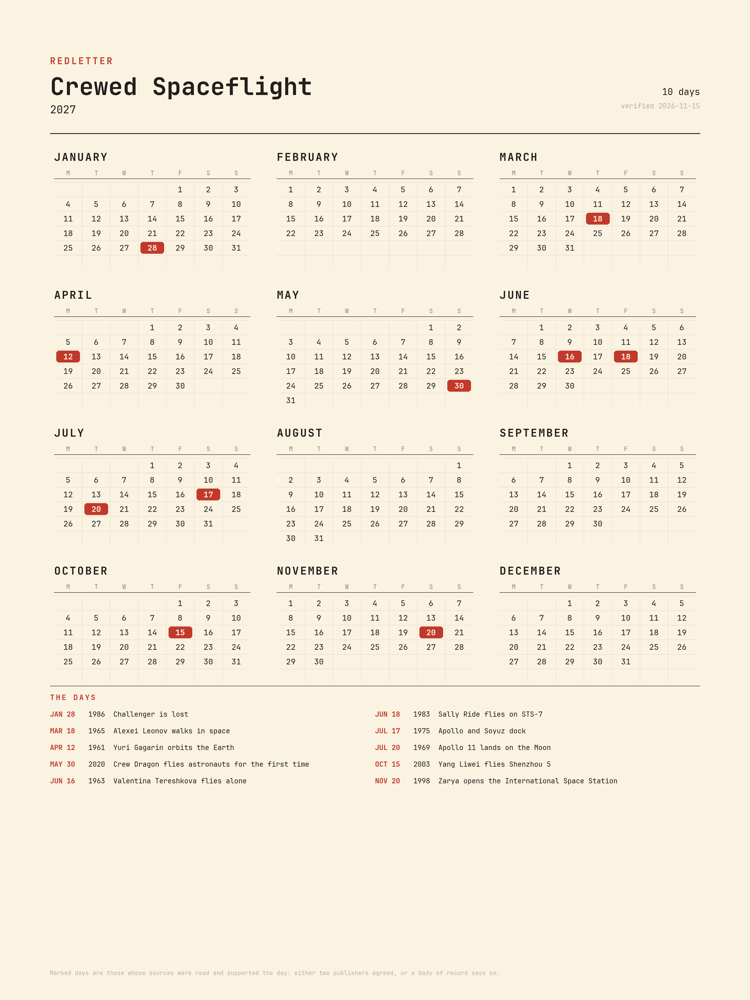

# Redletter

<div align="center">
    
</div>

**Calendars of the days a field marks in red.**

You name a topic. The days a field keeps are researched, each one sourced, each
one checked against its sources, and the ones that hold up are printed as a year
in black and white with a single red mark per day — plus an `.ics` feed that
repeats them every year on your phone.

<p>
    
    
    
    
</p>



---

## What this is

A red-letter day is a day printed in red ink: a feast in a missal, a holiday in an
almanac, a date the field stops for. Redletter makes that calendar for any field —
spaceflight, chemistry, printing, mountains — out of days that can prove
themselves.

The list is the cheap part. Anyone can produce a list of interesting dates in an
afternoon, and half of them will be wrong, undated, or one person's memory of a
newspaper. So the thing this repository actually builds is the **gate**:

- every day is a record with its date, its precision and its sources;
- every source is fetched and asked whether it supports that date;
- agreement only counts when it comes from **more than one publisher** — two
  Wikipedia articles are two pages but one publisher, and on a well-watched article
  they are often the same editors;
- a day that fails the gate stays out of the picture. Not footnoted, not marked
  with an asterisk: out.

## Status

The vertical slice runs, on three calendars, end to end. What is true today:

- **`data/chemistry.yaml`** — the field's year: **115 days, eight to twelve in
  every month**, from the Royal Society of Chemistry's "On This Day" archive, the
  Nobel Foundation and IUPAC. Mendeleev's table, the isolation of fluorine, the
  first noble-gas compound, Curie's radium, Pauling's death, the naming of
  elements 118. Every day is a dated event with a body of record behind it, and
  **115 of 115 verify**.
- **`data/chemistry-laureates.yaml`** — the people calendar: **72 days, six in
  every month**, built from the Nobel Prize's own API through
  `scripts/from_nobel.py`. Every laureate of the chemistry prize, on the day they
  were born, with the prize year and the citation in the line.
- **`data/spaceflight.yaml`** — ten hand-curated crewed-spaceflight days.

- **`scripts/verify_days.py`** fetches every source and derives each day's status.
  Spaceflight reads **10 active, 0 provisional, 0 contested, 0 quarantined** — 20
  sources across four publishers; chemistry reads **115 active** of 115.
- **`scripts/from_lines.py`** turns a researcher's `MM-DD | YYYY | sentence | URL |
  publisher` file into candidate records, refusing malformed lines and catching a
  date that contradicts its own source URL before any request is made.
- **`scripts/render_grid.py`** draws the 2027 sheet (a year of month grids) or one
  month, as a PNG to look at, an SVG to print, and — with `--pdf` — a book: a cover
  page, then one page per month with each day's detail printed inside its date
  cell. All three emitters draw the same list of primitives, so the screen, the
  print and the book cannot disagree about a page.
- **`scripts/build_ics.py`** writes all-day, yearly-repeating events and parses the
  file back before it lands: DATE values, a YEARLY rule and a UID on every event,
  CRLF, no line over 75 octets.
- **`tests/`** — 145 tests: unit tests that pin the status rules, the date matcher
  and the research format with the network faked, and integration tests that run
  all three scripts against a local web server. The one network test is opt-in. CI
  runs the offline suite on 3.9 and 3.12.
- **Not built yet:** the skills that research and verify a *new* topic end to end.
  The intake side exists — a formatted file in, judged candidates out — but
  finding the days is still a person or an assistant doing research.
- **Not proven yet:** that the feed imports into Apple Calendar or Google Calendar.
  It parses cleanly; nobody has subscribed to it and looked.

## Tests

```sh
pip install -r requirements.txt -r requirements-dev.txt
pytest -q                     # 145 tests, offline, about seven seconds
pytest --run-network -k network   # the shipped dataset against the real sources
```

The suite is split on purpose. **Unit tests** replace the network with a fake and
pin the rules that are easy to break by accident: the status ladder
(`active` needs two *publishers*, not two pages), unread-is-not-disagreement, the
approval hash, the leap-year rule, and that the `.ics` reads back the way a client
would parse it. **Integration tests** run all three scripts as a person does,
against a local web server this repository starts, so real HTTP, real YAML and real
files are exercised without touching the internet. The one network test is opt-in:
it fails when a publisher moves a page, which is a fact about the web rather than
about this code.

CI runs the offline suite on Python 3.9 and 3.12 on every push.

## Quick start

```sh
python3 -m venv .venv && . .venv/bin/activate
pip install -r requirements.txt

python scripts/verify_days.py data/spaceflight.yaml --write   # fetch, judge, write out/days.json
python scripts/render_grid.py out/days.json --year 2027        # out/…-2027.png and .svg
python scripts/render_grid.py out/days.json --month 7          # one month, bigger
python scripts/render_grid.py out/days.json --pdf              # book: 13 pages, A4 landscape
python scripts/render_grid.py out/days.json --pdf --paper letter --orientation portrait
python scripts/build_ics.py out/days.json                      # out/…-2027.ics, validated
python scripts/coverage.py out/days.json --target 6            # how dense the year is

# turn a researcher's lines into candidates, then put them through the same gate
python scripts/from_lines.py research.md --out data/_candidates.yaml --id-prefix R
python scripts/verify_days.py data/_candidates.yaml --write

# propose records from the Nobel Prize API, then put them through the same gate
python scripts/from_nobel.py --category che --out data/_candidates.yaml

# rebuild the icon set from the artwork as it arrived
python tools/icon.py spec/icon-source/icon-source.png
```

`--write` is what makes `out/days.json`; the renderer and the feed writer both read
it and both skip anything that is not `active`, saying what they skipped.

## What a day is

A day is a record, not a sentence. This is `D-0008` from the seed topic:

```yaml
- id: D-0008
  month_day: "11-20"
  year: 1998
  kind: milestone
  title: Zarya opens the International Space Station
  blurb: >-
    The first station module to orbit, uncrewed, while its first crew waited
    two years for the module after it.
  date:
    as_recorded: 1998-11-20
    calendar: gregorian
    gregorian: 1998-11-20
    precision: day
  sources:
    - type: archive
      citation: NASA — International Space Station
      url: https://www.nasa.gov/international-space-station/
    - type: reference-data
      citation: International Space Station — Wikipedia
      url: https://en.wikipedia.org/wiki/International_Space_Station
```

`status`, agreement and the date it was checked are **not** written here. The
verifier writes them into `out/`. A fact with two homes has one home that is wrong.

## The gate

| Status | Meaning | Reaches the sheet |
| --- | --- | --- |
| `active` | two or more agreeing sources from two or more publishers, **or** one agreeing source from a publisher on the allowlist | yes |
| `provisional` | they agree, but it is one publisher, or only one agreeing source | no |
| `contested` | sources were read and disagreed about the day | no |
| `quarantined` | nothing could be read | no |

`data/sources-allowlist.yaml` is the visible exception to the two-publisher rule: a
body of record — the Nobel Foundation, the ACS, the RSC, IUPAC — is enough on its
own, because a second website repeating it adds nothing. It is a short list, it is
in the repository, and every day it vouches for says so in its `basis` field.

`contested` days are off the sheet by the owner's decision: a red mark means the
day held up, and a mark that needs an explanation in the margin is not that.

## The two outputs

The printed sheet is a **dated year**: the mark falls on a real 2027 date, and the
key at the foot says which year the thing actually happened.

The feed is a **recurrence**: `DTSTART` in 2027 with `RRULE:FREQ=YEARLY`, so the mark
comes back on the same month-day forever. Starting the series in 1961 would fill a
new subscriber's calendar with sixty-five years of past events the first time they
imported it.

## Repository layout

```
data/                the days, one YAML per calendar, and the source allowlist
scripts/
  verify_days.py     the gate: fetch, judge, derive status, write out/days.json
  from_lines.py      turns a researcher's lines into candidates for the gate
  from_nobel.py      proposes day records from the Nobel Prize API
  coverage.py        active days per month against a target
  render_grid.py     the sheet: a year of month grids, PNG and SVG, and the 13-page book
  build_ics.py       the feed: all-day yearly events, parsed back before it is written
tools/icon.py        turns the supplied artwork into the icon size set
tests/               unit tests, plus integration tests that run the pipeline
spec/icon-source/    the artwork as it arrived, so the icons can be rebuilt
media/icons/         icon-{1024,512,256,192,128} in PNG, and the same in WebP under web/
media/samples/       the rendered 2027 sheet, its SVG, and the .ics
out/                 generated, gitignored
SPEC.md              what the slice claims and what it deliberately does not
DECISIONS.md         every choice a reader could have made differently, and why
```

## What is not done

- The research skills — find candidates for a topic, verify them, propose them for
  approval. The intake half exists (`from_lines.py` and the gate); the finding is
  still done by a person or an assistant, and the brief they are given is in
  `DECISIONS.md` under "Research arrives as lines".
- Contested days, drawn differently or at all. The status is computed; nothing
  renders it.
- A policy for a word wider than its date cell. `wrap_to` deliberately leaves such
  a word whole rather than invent a hyphen, so on the book form it can print past
  the column divider: six cells across the three default A4 landscape books, the
  worst 12.6 pt past (`International`, spaceflight, 20 November; `Euler-Chelpin`,
  laureates, February), and 104 across the three datasets at all four paper
  shapes. Every line the wrapper itself produced does stay inside its cell; this is
  the single-word exception, and it is not decided how to break such a word.
- Any colour beyond the one red.
- A person importing the `.ics` into a real calendar and saying what happened.

## License

MIT. See [`LICENSE`](LICENSE).
