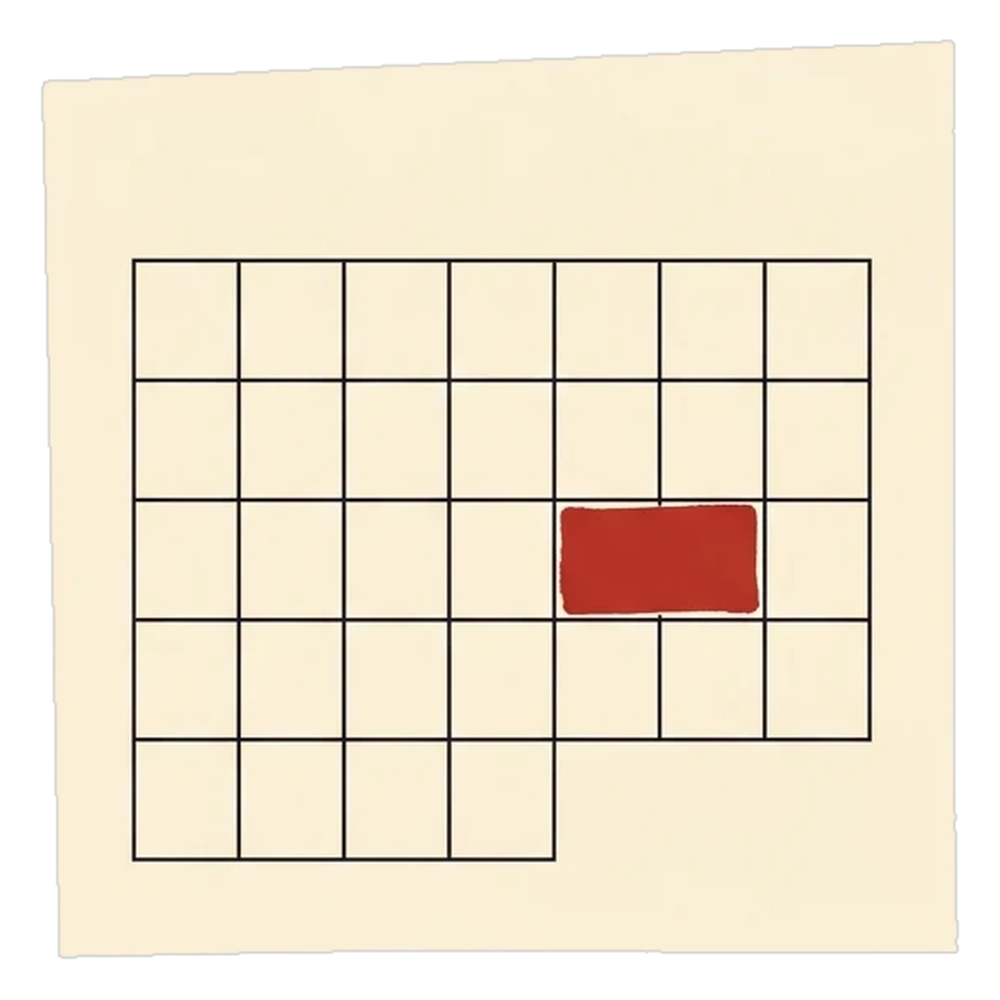

# Redletter

<div align="center">
    
</div>

**Calendars of the days a field marks in red.**

You name a topic. The days a field keeps are researched, each one sourced, each
one checked against its sources, and the ones that hold up are printed as a year
in black and white with a single red mark per day — plus an `.ics` feed that
repeats them every year on your phone.

<p>
    
    
    
    
</p>


---

## What this is

A red-letter day is a day printed in red ink: a feast in a missal, a holiday in an
almanac, a date the field stops for. Redletter makes that calendar for any field —
spaceflight, chemistry, printing, mountains — out of days that can prove
themselves.

The list is the cheap part. Anyone can produce a list of interesting dates in an
afternoon, and half of them will be wrong, undated, or one person's memory of a
newspaper. So the thing this repository actually builds is the **gate**:

- every day is a record with its date, its precision and its sources;
- every source is fetched and asked whether it supports that date;
- agreement only counts when it comes from **more than one publisher** — two
  Wikipedia articles are two pages but one publisher, and on a well-watched article
  they are often the same editors;
- a day that fails the gate stays out of the picture. Not footnoted, not marked
  with an asterisk: out.

## Status

The vertical slice runs, on one topic, end to end. What is true today:

- **`scripts/verify_days.py`** fetches every source for the ten seed days and
  derives each day's status. The seed topic currently reads **10 active, 0
  provisional, 0 contested, 0 quarantined** — 20 sources across four publishers.
- **`scripts/render_grid.py`** draws the 2027 sheet (a year of month grids) or one
  month, as a PNG to look at and an SVG to print, from the same geometry.
- **`scripts/build_ics.py`** writes ten all-day, yearly-repeating events and parses
  the file back before it lands: DATE values, a YEARLY rule and a UID on every
  event, CRLF, no line over 75 octets.
- **Not built yet:** the skills that research and verify a *new* topic. The ten
  days were curated by hand, which is the part that does not scale.
- **Not proven yet:** that the feed imports into Apple Calendar or Google Calendar.
  It parses cleanly; nobody has subscribed to it and looked.

## Quick start

```sh
python3 -m venv .venv && . .venv/bin/activate
pip install -r requirements.txt

python scripts/verify_days.py data/spaceflight.yaml --write   # fetch, judge, write out/days.json
python scripts/render_grid.py out/days.json --year 2027        # out/…-2027.png and .svg
python scripts/render_grid.py out/days.json --month 7          # one month, bigger
python scripts/build_ics.py out/days.json                      # out/…-2027.ics, validated

# rebuild the icon set from the artwork as it arrived
python tools/icon.py spec/icon-source/icon-source.png
```

`--write` is what makes `out/days.json`; the renderer and the feed writer both read
it and both skip anything that is not `active`, saying what they skipped.

## What a day is

A day is a record, not a sentence. This is `D-0008` from the seed topic:

```yaml
- id: D-0008
  month_day: "11-20"
  year: 1998
  kind: milestone
  title: Zarya opens the International Space Station
  blurb: >-
    The first station module to orbit, uncrewed, while its first crew waited
    two years for the module after it.
  date:
    as_recorded: 1998-11-20
    calendar: gregorian
    gregorian: 1998-11-20
    precision: day
  sources:
    - type: archive
      citation: NASA — International Space Station
      url: https://www.nasa.gov/international-space-station/
    - type: reference-data
      citation: International Space Station — Wikipedia
      url: https://en.wikipedia.org/wiki/International_Space_Station
```

`status`, agreement and the date it was checked are **not** written here. The
verifier writes them into `out/`. A fact with two homes has one home that is wrong.

## The gate

| Status | Meaning | Reaches the sheet |
| --- | --- | --- |
| `active` | two or more agreeing sources, from two or more publishers | yes |
| `provisional` | they agree, but it is one publisher, or only one agreeing source | no |
| `contested` | sources were read and disagreed about the day | no |
| `quarantined` | nothing could be read | no |

`contested` days are off the sheet by the owner's decision: a red mark means the
day held up, and a mark that needs an explanation in the margin is not that.

## The two outputs

The printed sheet is a **dated year**: the mark falls on a real 2027 date, and the
key at the foot says which year the thing actually happened.

The feed is a **recurrence**: `DTSTART` in 2027 with `RRULE:FREQ=YEARLY`, so the mark
comes back on the same month-day forever. Starting the series in 1961 would fill a
new subscriber's calendar with sixty-five years of past events the first time they
imported it.

## Repository layout

```
data/                the days, one YAML per topic
scripts/
  verify_days.py     the gate: fetch, judge, derive status, write out/days.json
  render_grid.py     the sheet: a year of month grids, PNG and SVG from one geometry
  build_ics.py       the feed: all-day yearly events, parsed back before it is written
tools/icon.py        turns the supplied artwork into the icon size set
spec/icon-source/    the artwork as it arrived, so the icons can be rebuilt
media/icons/         icon-{1024,512,256,192,128} in PNG, and the same in WebP under web/
media/samples/       the rendered 2027 sheet, its SVG, and the .ics
out/                 generated, gitignored
SPEC.md              what the slice claims and what it deliberately does not
DECISIONS.md         every choice a reader could have made differently, and why
```

## What is not done

- The research skills — find candidates for a topic, verify them, propose them for
  approval. This is the next slice and the one that makes the idea worth a
  repository.
- Contested days, drawn differently or at all. The status is computed; nothing
  renders it.
- Any second topic, and any colour beyond the one red.
- A person importing the `.ics` into a real calendar and saying what happened.

## License

MIT. See [`LICENSE`](LICENSE).
